<picture>
  <source media="(prefers-color-scheme: dark)" srcset="./assets/header-dark.svg">
  <source media="(prefers-color-scheme: light)" srcset="./assets/header-light.svg">
  
</picture>

  

## Sobre mí

Desarrollador de software con enfoque backend en **Java** y **Spring Boot**, desde Ambato, Ecuador.
Construyo aplicaciones web de punta a punta: APIs REST, bases de datos, integraciones y frontends con React y Angular.

English

 

Software developer focused on backend with **Java** and **Spring Boot**, based in Ambato, Ecuador.
I build web applications end to end: REST APIs, databases, integrations and frontends with React and Angular.

  

## Stack

  <picture>
    <source media="(prefers-color-scheme: light)" srcset="https://skillicons.dev/icons?i=java,spring,hibernate,nodejs,php,postgres,docker,git,react,angular,ts,tailwind,figma,notion&theme=light">
    
  </picture>
    
  
  
  
  
  
  
  

## Actividad

  <picture>
    <source media="(prefers-color-scheme: dark)" srcset="https://raw.githubusercontent.com/W1llAn/W1llAn/main/assets/stats-dark.svg">
    
  </picture>
  <picture>
    <source media="(prefers-color-scheme: dark)" srcset="https://raw.githubusercontent.com/W1llAn/W1llAn/main/assets/top-langs-dark.svg">
    
  </picture>

<picture>
  <source media="(prefers-color-scheme: dark)" srcset="https://raw.githubusercontent.com/W1llAn/W1llAn/output/github-snake-dark.svg">
  
</picture>

## Contacto

¿Hablamos? Escríbeme desde el <a href="https://w1llan.github.io/portfolio/" target="_blank" rel="noopener noreferrer">formulario de mi portafolio</a> &nbsp; 
